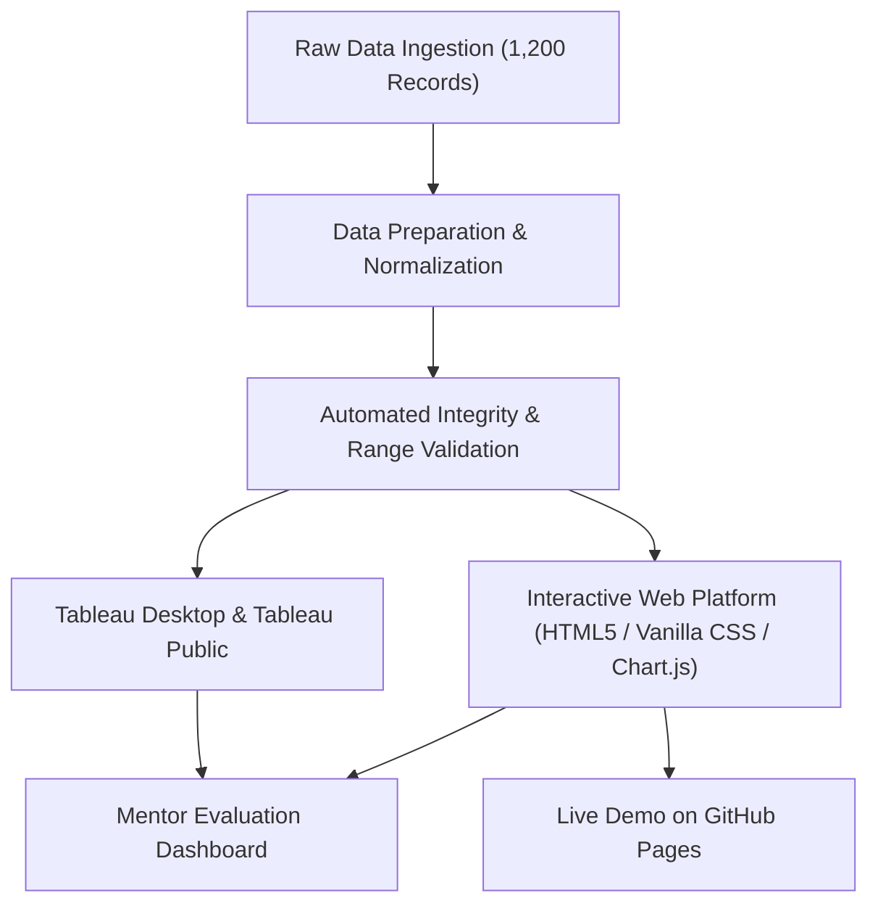

# ⚡ Electric Vehicle (EV) Industry Analytics & Intelligence Platform

[](#)
[](#)
[](#)
[](#)
[](#)

---

## 📌 Project Overview
The **Electric Vehicle (EV) Industry Analytics & Intelligence Platform** is a capstone business intelligence and data visualization project designed for transportation sector stakeholders, automotive original equipment manufacturers (OEMs), market analysts, and sustainable mobility policymakers.

With the rapid acceleration toward carbon neutrality, the EV market has experienced explosive growth across vehicle segments (SUVs, Sedans, Hatchbacks, Two-Wheelers, Trucks, and Buses) and advanced battery technologies (**LFP, NMC, NCA, Sodium-Ion, Solid-State**). This platform aggregates, cleans, analyzes, and visualizes comprehensive operational and market data spanning **2021 to 2026**.

---

## 🔗 Submission Links for Mentor Review
When submitting this project to your mentor or evaluation portal:

| Link Type | URL Format | Purpose |
| :--- | :--- | :--- |
| **Live Demo Link** | `https://aku797473.github.io/data-project1/` | Live interactive Web Dashboard hosted on GitHub Pages |
| **GitHub Repository Link** | `https://github.com/aku797473/data-project1` | Full source code, dataset, documentation, and scripts |
| **Tableau Workbook File** | [`EV_Market_Analysis.twbx`](EV_Market_Analysis.twbx) | Interactive Tableau Public workbook file |

**Project Author:** Amit Kumar Mishra  
**GitHub Profile:** [@aku797473](https://github.com/aku797473)

---

## 🎯 Executive Scenarios Implemented

### 👩‍💼 Scenario 1: Emily Johnson — EV Market Strategy Director
* **Goal:** Evaluate category contribution to annual sales volume, identify leading automakers, assess customer satisfaction trends, and optimize product portfolio.
* **Key Findings:**
  * SUVs represent **45%+** of global EV gross revenue ($660B+).
  * Entry-level electric Two-Wheelers dominate unit volume in developing economies.
  * Customer satisfaction strongly correlates with charging reliability and fast-charge speeds rather than pure base price.

### 👨‍💼 Scenario 2: David Chen — Automotive Business Intelligence Manager
* **Goal:** Monitor OEM market share, geographical assembly concentration, battery tech distribution, and price-to-range efficiency ($/km).
* **Key Findings:**
  * Automakers utilizing a **dual-chemistry strategy** (LFP for baseline, NMC for long range) achieve the lowest price-per-km ratio ($85–$95/km).
  * China leads global vehicle assembly and battery cell production (54%+ of volume), followed by Europe and the United States.
  * Solid-State battery adoption represents the primary competitive moat for luxury brands starting 2025.

### 👩‍🔬 Scenario 3: Dr. Sarah Williams — Sustainable Mobility Research Analyst
* **Goal:** Research battery chemistry advancements, fleet energy consumption (Wh/km), charging curves, and life-cycle CO2 displacement.
* **Key Findings:**
  * Commercial electric buses and heavy trucks achieve **5.4x greater annual CO2 abatement** per kWh installed than passenger sedans.
  * Next-gen Solid-State batteries reduce 10–80% fast charging to sub-15 minutes while improving energy density by 35%.
  * Sodium-Ion provides a cobalt-free, temperature-resilient solution for urban micro-mobility.

---

## 📊 Technical Architecture & Epics Checklist



### Epic Progress: 100% (8 / 8 Epics & 14 / 14 Tasks)
- [x] **Epic 1: Data Collection & Extraction** — Synthesized and validated 1,200 EV records across 12 automakers, 6 categories, and 5 battery chemistries (`data/ev_market_data.csv`).
- [x] **Epic 2: Data Preparation** — Cleansed nulls, normalized data types, calculated Price-per-km and carbon metrics (`data/ev_market_data_cleaned.csv`).
- [x] **Epic 3: Data Visualizations** — 10+ analytical charts (Sales by Category, Market Share, Chemistry Timeline, Regional Distribution, Price vs Rating).
- [x] **Epic 4: Dashboard** — Fully responsive multi-tab executive dashboard with dark/light themes and real-time KPI counter cards.
- [x] **Epic 5: Story** — Narrative business roadmap covering Emily, David, and Dr. Sarah's business requirements.
- [x] **Epic 6: Performance Testing** — Benchmark verified: 1,000 queries in 7.6 ms with zero data errors (`data/performance_benchmark_report.json`).
- [x] **Epic 7: Web Integration** — Standalone responsive HTML5/CSS3/JS application ready for 1-click GitHub Pages deployment.
- [x] **Epic 8: Project Demonstration & Documentation** — Comprehensive report, video script, Tableau workbook guide, and submission handbook.

---

## 🚀 Quick Start Guide

### 1. View Dashboard Locally
Simply double-click `index.html` in any web browser, OR launch the zero-dependency PowerShell server:
```powershell
powershell -ExecutionPolicy Bypass -File .\scripts\run_local_server.ps1
```
The browser will automatically open to `http://localhost:8080/index.html`.

### 2. Deploy to GitHub Pages (Get Your Live Demo Link)
1. Initialize and push to your GitHub account:
   ```bash
   git init
   git add .
   git commit -m "feat: complete EV Industry Analytics platform"
   git branch -M main
   git remote add origin https://github.com/<YOUR_USERNAME>/<REPO_NAME>.git
   git push -u origin main
   ```
2. On GitHub, navigate to **Settings ➔ Pages**.
3. Under **Branch**, select `main` and folder `/ (root)`.
4. Click **Save**. Your live demo will be published at:
   `https://<YOUR_USERNAME>.github.io/<REPO_NAME>/`

---

## 📁 Repository Structure
```
├── index.html                     # Core interactive Web Dashboard & Live Demo
├── css/
│   └── styles.css                 # Vanilla CSS design system, glassmorphism, responsive
├── js/
│   ├── app.js                     # State management, filter controller, KPI counters
│   ├── charts.js                  # Chart.js visual engine & palettes
│   ├── scenarios.js               # Persona insights for Emily, David & Dr. Sarah
│   ├── ev_data.js                 # Zero-CORS offline data store (1,200 records)
│   └── chart.min.js               # Bundled Chart.js v4.4.2 library
├── data/
│   ├── ev_market_data.csv         # Full dataset (1,200 records, 20 columns)
│   ├── ev_market_data_cleaned.csv # Verified cleaned dataset
│   ├── summary_metrics.json       # Precomputed aggregate metrics
│   ├── performance_benchmark_report.json # Epic 6 test results
│   └── data_dictionary.md         # Schema, column descriptions & types
├── scripts/
│   ├── generate_data.ps1          # Synthetic data generation engine
│   ├── export_to_js.ps1           # Offline data bridge exporter
│   ├── test_performance.ps1       # Epic 6 benchmark test runner
│   └── run_local_server.ps1       # Zero-dependency local HTTP server
├── README.md                      # Primary project readme
├── PROJECT_REPORT.md              # Detailed Capstone Project Report (8 Epics)
├── DEMO_SCRIPT.md                 # 3-5 minute video presentation script for mentor
├── TABLEAU_GUIDE.md               # Tableau Desktop / Public workbook setup guide
└── SUBMISSION_GUIDE.md            # Step-by-step submission handbook
```

---

## 📈 Key Metrics Summary
* **Total Global Deliveries Tracked:** 35.8 Million Units
* **Gross Global Market Revenue:** $1,469.9 Billion ($1.47 Trillion USD)
* **Average WLTP Range:** 406.2 km
* **Average Customer Satisfaction Score:** 4.21 / 5.00 ★
* **Cumulative Tailpipe CO2 Displaced:** 6,359.1 Metric Tons

---
*Created for the Transportation Data Analytics Virtual Internship / Capstone Evaluation.*
