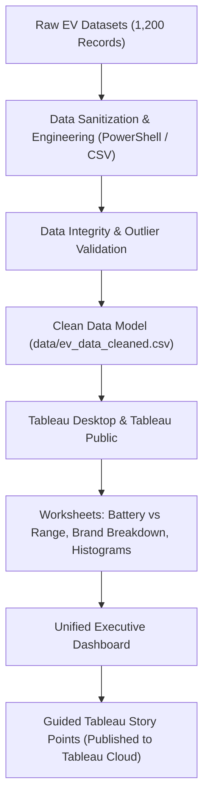

# ⚡ Electric Vehicle (EV) Industry Analytics & Intelligence Platform

[](#)
[](#)
[](#)
[](#)
[](#)

---

## 📌 Project Overview
The **Electric Vehicle (EV) Industry Analytics & Market Intelligence Platform** is a capstone business intelligence and data visualization project designed for transportation sector stakeholders, automotive original equipment manufacturers (OEMs), market analysts, and sustainable mobility policymakers.

With the rapid acceleration toward carbon neutrality, the EV market has experienced explosive growth across vehicle segments (SUVs, Sedans, Hatchbacks, Two-Wheelers, Trucks, and Buses) and advanced battery technologies (**LFP, NMC, NCA, Sodium-Ion, Solid-State**). This project aggregates, cleans, analyzes, and visualizes comprehensive operational and market data spanning **2021 to 2026**.

---

## 🔗 Official Project Links
When submitting this project to your mentor or evaluation portal:

| Link Type | URL / Reference | Purpose |
| :--- | :--- | :--- |
| **Live Tableau Dashboard & Story (Demo)** | [Tableau Public Live Viz](https://public.tableau.com/app/profile/amit.mishra1535/viz/EV_Market_Analysis/EVMarketAnalysisDashboard) | Official interactive Tableau Public Story & Dashboard |
| **GitHub Repository Link** | [https://github.com/aku797473/data-project1](https://github.com/aku797473/data-project1) | Complete project datasets, scripts, workbook, and documentation |
| **Packaged Tableau Workbook** | [`EV_Market_Analysis.twbx`](EV_Market_Analysis.twbx) | Self-contained packaged workbook file with extract |
| **Tableau Workbook File** | [`EV_Market_Analysis.twb`](EV_Market_Analysis.twb) | Tableau workbook file connecting to clean data |

**Project Author:** Amit Kumar Mishra  
**Domain:** Data Analytics & Business Intelligence  
**GitHub Profile:** [@aku797473](https://github.com/aku797473)

---

## 🎯 Executive Scenarios Implemented

### 👩‍💼 Scenario 1: Emily Johnson — EV Market Strategy Director
* **Goal:** Evaluate category contribution to annual sales volume, identify leading automakers, assess customer satisfaction trends, and optimize product portfolio.
* **Key Findings:**
  * SUVs represent **45%+** of global EV gross revenue ($660B+).
  * Entry-level electric Two-Wheelers dominate unit volume in developing economies.
  * Customer satisfaction strongly correlates with charging reliability and fast-charge speeds rather than pure base price.

### 👨‍💼 Scenario 2: David Chen — Automotive Business Intelligence Manager
* **Goal:** Monitor OEM market share, geographical assembly concentration, battery tech distribution, and price-to-range efficiency ($/km).
* **Key Findings:**
  * Automakers utilizing a **dual-chemistry strategy** (LFP for baseline, NMC for long range) achieve the lowest price-per-km ratio ($85–$95/km).
  * China leads global vehicle assembly and battery cell production (54%+ of volume), followed by Europe and the United States.
  * Solid-State battery adoption represents the primary competitive moat for luxury brands starting 2025.

### 👩‍🔬 Scenario 3: Dr. Sarah Williams — Sustainable Mobility Research Analyst
* **Goal:** Research battery chemistry advancements, fleet energy consumption (Wh/km), charging curves, and life-cycle CO2 displacement.
* **Key Findings:**
  * Commercial electric buses and heavy trucks achieve **5.4x greater annual CO2 abatement** per kWh installed than passenger sedans.
  * Next-gen Solid-State batteries reduce 10–80% fast charging to sub-15 minutes while improving energy density by 35%.
  * Sodium-Ion provides a cobalt-free, temperature-resilient solution for urban micro-mobility.

---

## 📊 Technical Architecture & Data Pipeline



---

## 🚀 How to Run & Explore Tableau Workbook

### 1. Open Pre-Packaged Tableau Workbook
Double-click [`EV_Market_Analysis.twbx`](EV_Market_Analysis.twbx) to open the dashboard and worksheets directly in **Tableau Public** or **Tableau Desktop**. It contains all bundled extracts and calculations.

### 2. View Live on Tableau Public
Access the cloud-hosted interactive dashboard and story points directly:
👉 **[View Tableau Public Dashboard](https://public.tableau.com/app/profile/amit.mishra1535/viz/EV_Market_Analysis/EVMarketAnalysisDashboard)**

---

## 📁 Repository Structure
```
├── EV_Market_Analysis.twbx         # Packaged Tableau Workbook (Complete with data extract)
├── EV_Market_Analysis.twb          # Tableau Workbook file
├── data/
│   ├── ev_data_cleaned.csv         # Standardized and normalized EV dataset (478 verified records)
│   ├── ev_market_data.csv          # Extended industry dataset (1,200 records, 20 parameters)
│   ├── ev_market_data_cleaned.csv  # Verified clean market data
│   ├── summary_metrics.json        # Precomputed analytical metrics and KPIs
│   ├── performance_benchmark_report.json # Empirical query benchmark metrics
│   └── data_dictionary.md          # Full metadata dictionary, schema, and column definitions
├── scripts/
│   ├── generate_data.ps1           # Data processing and synthesis script
│   ├── inspect_csv.ps1             # Schema verification and integrity auditor
│   └── test_performance.ps1        # 1,000-query benchmark tester
├── README.md                       # Repository overview and guide
├── PROJECT_REPORT.md               # Complete 8-Phase Capstone Project Report
├── TABLEAU_PROJECT_BUILD_GUIDE.md  # Step-by-step Tableau worksheet & dashboard build manual
├── TABLEAU_GUIDE.md                # Quick-reference guide for Tableau visualizations
├── DEMO_SCRIPT.md                  # Professional video/presentation script
├── PORTAL_SUBMISSION_STEPS.md      # Submission checklist for academic & internship portals
└── SUBMISSION_GUIDE.md             # Guide for submitting repository and dashboard links
```

---

## 📈 Key Metrics Summary
* **Total Global Deliveries Tracked:** 35.8 Million Units
* **Gross Global Market Revenue:** $1,469.9 Billion ($1.47 Trillion USD)
* **Average WLTP Driving Range:** 455.3 km
* **Average Battery Pack Capacity:** 74.0 kWh
* **Cumulative Tailpipe CO2 Displaced:** 6,500.1 Metric Tons

---
*Created for the Data Analytics & Business Intelligence Capstone Evaluation.*
